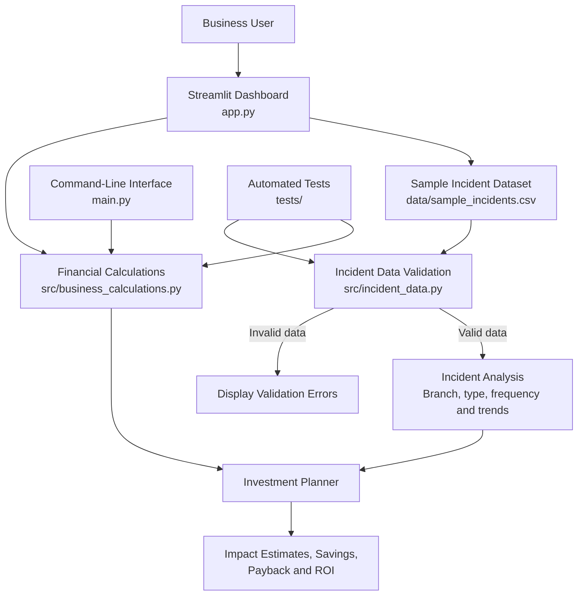

# BranchPulse — System Architecture

## Overview

BranchPulse is a Python-based prototype for estimating the financial impact of technology incidents and evaluating potential technology investments.

The application has a Streamlit dashboard, a reusable financial calculation module, an incident-data validation module, a CSV dataset, and an automated test suite.

## Architecture Diagram



## Main Components

### 1. Streamlit Dashboard — `app.py`

Provides the user interface for business-impact estimates, investment comparisons, sensitivity analysis, incident exploration, and investment planning.

### 2. Incident Dataset — `data/sample_incidents.csv`

Contains synthetic incident records used to demonstrate the application. Each record includes incident details, duration, transaction assumptions, a lost-transaction fraction, and recovery costs.

### 3. Incident Data Validation — `src/incident_data.py`

Checks required columns, incident identifiers, dates, text fields, and numeric ranges before the Incident Explorer calculates estimated impact.

### 4. Financial Calculation Engine — `src/business_calculations.py`

Contains reusable calculations for estimated business impact, investment returns, investment comparisons, savings scenarios, and potentially preventable impact.

### 5. Command-Line Interface — `main.py`

Provides a terminal-based interface for the existing financial calculators.

### 6. Automated Tests — `tests/`

Tests the financial calculations and incident-data validation logic independently of the dashboard.

## Data Flow

1. A user opens the Streamlit dashboard and enters assumptions or selects incident filters.
2. The Incident Explorer loads the CSV dataset and checks it with the validation module.
3. Valid incident records are analysed to estimate financial impact and summarise incidents by branch, incident type, and week.
4. The Investment Planner uses selected incident records and an assumed preventable fraction to estimate annualised gross savings.
5. The financial calculation engine evaluates investment costs, annual maintenance, net benefit, payback, and first-year ROI.
6. The dashboard displays estimates and scenario comparisons for the user to evaluate.

## Testing Strategy

The automated tests cover calculation results, invalid financial inputs, investment comparisons, savings scenarios, preventable-impact estimates, and incident-data validation.

Run the tests using:

```powershell
python -m pytest -v
```

## Current Limitations

- The included incident data is synthetic.
- Financial outputs depend on user-provided assumptions.
- Annualised savings are estimates, not guaranteed returns.
- The application has not yet been validated through customer interviews or real-world deployment.
- The prototype does not independently verify the effectiveness of proposed technology investments.
